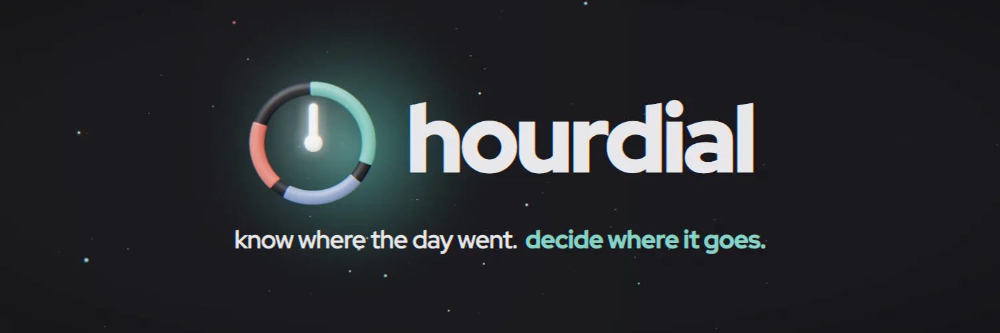

<h1 align="center">
  
</h1>

<p align="center">
  <a href="https://github.com/confuserdotcom/hourdial/actions/workflows/ci.yml"></a>
  <a href="LICENSE"></a>
</p>

<p align="center">
  <a href="#install">Install</a> ·
  <a href="docs/guide.md">Guide</a> ·
  <a href="docs/privacy.md">Privacy</a> ·
  <a href="CHANGELOG.md">Changelog</a>
</p>

**A local time tracker for developers: what you and your coding agents
worked on, per project, ready to bill. Nothing leaves your machine.**

You start no timer. A small recorder notes the app, window and site in
front of you, and reads your coding agents' session logs (entry types,
times, folders and session titles, never the text of prompts or replies). Rules you write once turn that into projects,
for past days too.

```
$ tock agents --week
project   agent     you  prompts  sessions
hourdial   4h36    1h51       54         7
agents worked 4h36 · you 1h51 in their windows · 2.5× leverage
```


What you get:

- **Your agents' time next to yours**, per project: how long Claude Code
  worked, how long you sat with it, and what you did meanwhile.
- **Projects without a timer.** Rules in `~/.config/tock/rules.toml` label
  the record and apply to past days, so fixing a rule fixes the history.
  Time no rule covers waits in an inbox; labelling it there writes the rule.
- **Ready to bill.** Rates per project and numbered invoices
  (`tock invoice issue`) that don't change when you relabel later.
- **A terminal UI, a dashboard on 127.0.0.1, and a macOS menu bar app.**

The command is `tock` (the project's earlier name); it will follow the new
name in a later release, and `tock` will keep working.

## Why you can trust it

A tracker sees every window you open, so it has to earn its place.

- **The recorder cannot phone home.** `trackd` and the menu bar app have no
  network code; a test fails the build if either links an HTTP or TLS
  client. Only `tock` talks to the network, for features that are off
  until you turn them on. [Privacy](docs/privacy.md) lists each one.
- **Agent logs stay metadata.** The agent ledger reads entry types, times,
  folders and session titles, never prompts, replies or tool output.
  Titles are written by Claude Code from your first prompts, so they can
  hint at a session's subject; [Privacy](docs/privacy.md) has the
  details.
- **Its accuracy is measured.** On every push, CI drives scripted sessions
  on real desktops and compares what was recorded with the clock. The
  worst error so far is 1.5 s per window or idle stretch on macOS and
  1.2 s on Linux; the job fails above 5 s.
- **No telemetry.** No usage data, crash reports or analytics.
- **One file you own.** Everything is one SQLite file. `tock export` writes
  CSV or JSON; `tock uninstall --purge` removes every trace.
- **Not yet:** an Apple Developer ID. The `.dmg` is not notarized and
  `tock setup` signs with a certificate made on your machine.

## Install

macOS, with Homebrew:

```sh
brew tap confuserdotcom/tock
brew trust confuserdotcom/tock
brew install tock
tock setup
```

`tock setup` makes a local code-signing certificate (so the Accessibility
grant survives upgrades), starts the recorder and the menu bar app, and
writes starter rules (`--template developer` picks the developer pack). It
asks for your password once, then for Accessibility and notifications. Run
it again after `brew upgrade tock`.

A `.dmg` is on the [releases page](https://github.com/confuserdotcom/hourdial/releases);
it isn't notarized, so the first open needs System Settings → Privacy &
Security → Open Anyway.

Linux (Hyprland, Sway, i3 or X11): `make install-linux`, or the tarball
from the releases page:

```sh
tar xzf tock-v*-linux-amd64.tar.gz && cd tock-v*-linux-amd64
install -m 755 trackd tock ~/.local/bin/ && ~/.local/bin/trackd install && tock init
tock setup --template developer --yes
```

[docs/verify.md](docs/verify.md) shows how to check any download. Windows
is experimental (see the guide). From source: see
[CONTRIBUTING.md](CONTRIBUTING.md).

## Using it

```sh
tock agents --week        # agent time next to yours, per project
tock today                # the day as text
tock inbox                # unlabelled time, grouped
tock tag 1 Code/hourdial  # label it and learn a rule
tock invoice issue        # bill a project
tock web                  # the dashboard
tock                      # terminal UI (? for keys)
```


## Why not ActivityWatch

[ActivityWatch](https://activitywatch.net) is free, open, local and on more
platforms. If you want a general record of everything, use it. hourdial is
narrower: it counts your coding agents' work next to your own, and goes
from the record to labelled projects to an invoice. Coming from
ActivityWatch, `tock import activitywatch export.json` brings your history.

## Docs

[Guide](docs/guide.md) · [Architecture](docs/architecture.md) ·
[Privacy](docs/privacy.md) · [Stability](docs/stability.md) ·
[Accessibility](docs/accessibility.md) · [Changelog](CHANGELOG.md) — also at
[confuserdotcom.github.io/hourdial](https://confuserdotcom.github.io/hourdial/).

## Contributing

See [CONTRIBUTING.md](CONTRIBUTING.md). hourdial is in a feature freeze
until ten people besides its author use it: fixes and polish are welcome,
new platforms and integrations wait. If you use it, say so in an issue;
that is what ends the freeze.

## License

MIT
